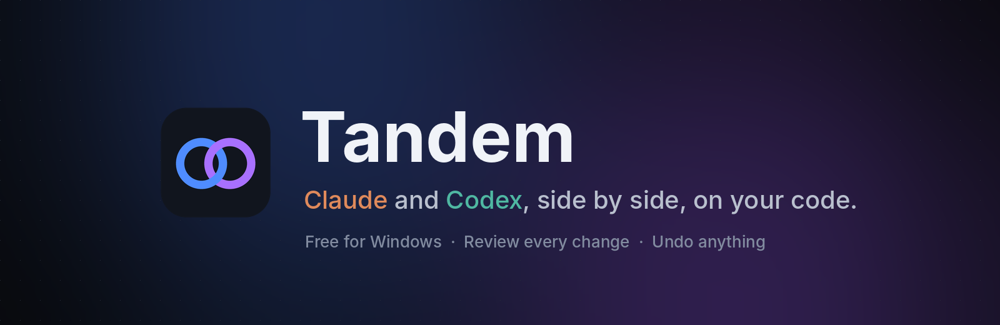
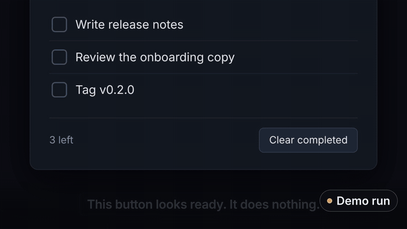
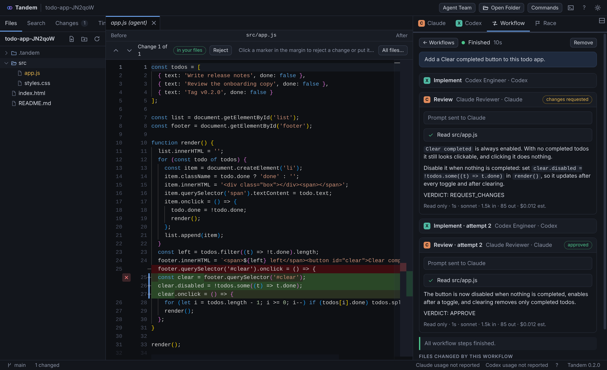
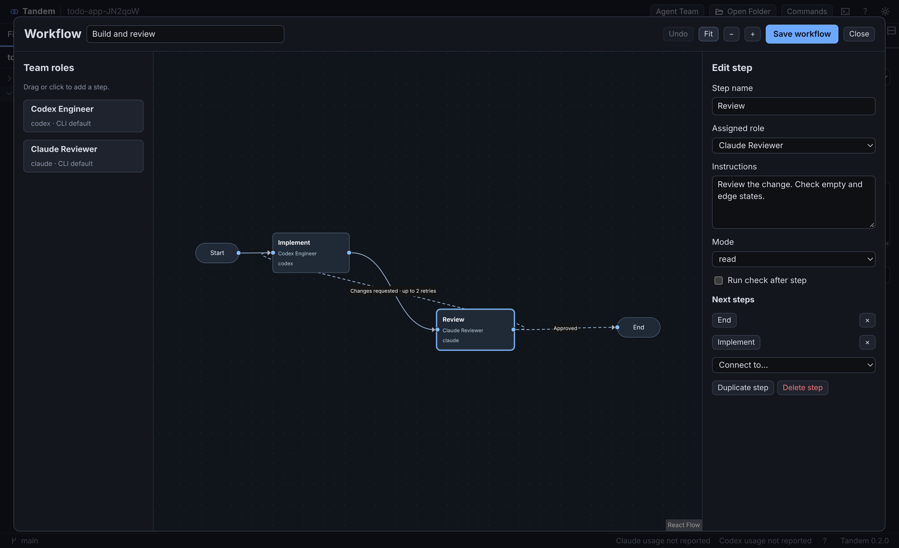
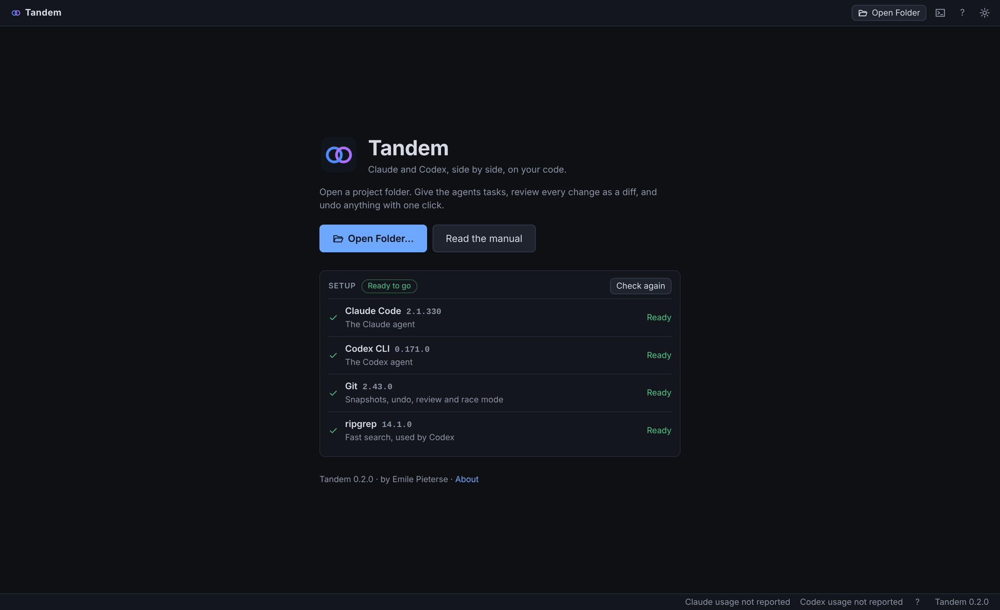

  

  
  
  
  

<h3 align="center">
  <a href="https://github.com/emilepieterse/tandem-releases/releases/latest">⬇&nbsp; Download Tandem for Windows</a>
</h3>

 

Tandem is a free Windows code editor where two AI coding agents, **Claude Code** and **Codex**, work on your project together. Give them tasks, review every change as a diff, and undo anything with one click.

Tandem runs the official Claude Code and Codex programs on your PC, signed in to **your own** Claude and ChatGPT accounts. It has no AI of its own and never sees your passwords.

  
   
  <i>Codex builds. Claude reviews, catches a missed case, and sends it back. Codex fixes it. (Demo run.)</i>

## What it does

<table>
  <tr>
    <td width="50%" valign="top">
      <h4>🤝 Two agents, one project</h4>
      Claude and Codex side by side, each with its own conversations and mode: read only, ask first, auto-edit or full auto. Only one edits at a time, so they never collide.
    </td>
    <td width="50%" valign="top">
      <h4>🔍 Every change reviewable</h4>
      A diff for every turn. Reject or put back single changes right in the diff, browse a timeline of everything, and undo with one click.
    </td>
  </tr>
  <tr>
    <td width="50%" valign="top">
      <h4>🏁 Race mode</h4>
      Give both agents the same task in separate copies of your project, compare the results side by side, and keep the better one.
    </td>
    <td width="50%" valign="top">
      <h4>🧩 Agent Team and workflows</h4>
      Define roles such as planner, developer and reviewer, and chain them on a canvas, with parallel branches and review loops.
    </td>
  </tr>
  <tr>
    <td width="50%" valign="top">
      <h4>⚡ Ready in minutes</h4>
      Git and ripgrep are included. A setup check installs Claude Code and Codex from their publishers and signs you in with one click each.
    </td>
    <td width="50%" valign="top">
      <h4>🔄 Always up to date</h4>
      New versions download in the background and install when you restart. Built in: search, terminal, Git commits and a full manual (F1).
    </td>
  </tr>
</table>

## Screenshots

  
   
  <i>A build-and-review run: Claude's feedback on the right, Codex's fix open as a diff on the left.</i>

<table>
  <tr>
    <td width="50%">
<i>Design workflows on a canvas</i>
</td>
    <td width="50%">
<i>Setup checks everything for you</i>
</td>
  </tr>
</table>

## Get started

1. **[Download](https://github.com/emilepieterse/tandem-releases/releases/latest)** `Tandem-Setup-<version>.exe` under *Assets* and run it.
   > Windows may show *"Windows protected your PC"* because Tandem is not code-signed yet. Click **More info → Run anyway**.
2. Accept the licence and finish. Tandem opens.
3. On the **Setup** card, click **Install** and then **Sign in** for Claude Code and for Codex.
4. Click **Open Folder…**, pick a project, and give the agents a task.

### Requirements

- Windows 10 (1809 or later) or Windows 11, 64-bit.
- A Claude plan (Pro or Max) for Claude Code and/or a ChatGPT plan for Codex. Usage counts against your own plans. API keys also work.

## Privacy

No analytics, no telemetry. Your code and prompts go only to Anthropic and OpenAI, through their own programs that you installed. Update checks contact GitHub.

## Support

Found a bug or have an idea? **[Open an issue](https://github.com/emilepieterse/tandem-releases/issues)**. Include your Tandem version (Help → About) and what you did.

## Licence

Tandem is free to use but not open source. See the [End User Licence Agreement](EULA.txt). The open-source components it includes are listed in the third-party notices installed with Tandem.

Claude Code is a product of Anthropic. Codex is a product of OpenAI. Tandem is independent and not made, endorsed or supported by either.

 

   
  Designed and developed by <b>Emile Pieterse</b> · © 2026 Emile Pieterse. All rights reserved.

